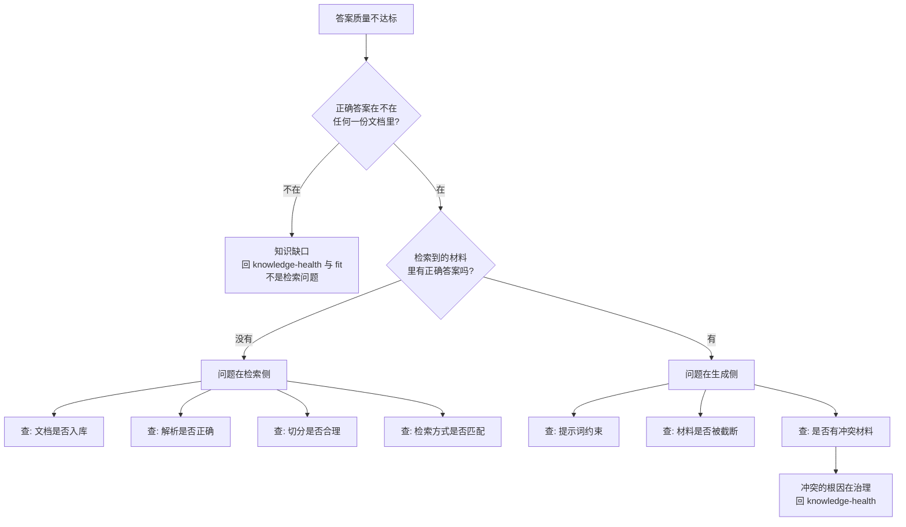

# 故障诊断流程：检索和生成分开看

答案质量不达标时，先回答一个问题：**检索到的材料里有正确答案吗？** 没有，是检索侧的问题；有，是生成侧的问题。把两侧混在一起调，只会越调越乱。（对应书稿图 15-2，在其上补了“知识侧”前置与出口。）

## 两侧各看什么

| 侧 | 看什么 | 指标 | 说明 |
|---|---|---|---|
| 检索侧 | 需要的材料有没有被找出来；找出来的材料有多少是相关的；正确答案是不是排在前面 | 召回、精度、排序（`scripts/retrieval_metrics.py` 的 recall@k、precision@k、MRR） | 需要评测题带标准出处才能算 |
| 生成侧 | 答案有没有超出给定材料范围；答案是否回答了问题；该拒答时有没有拒答 | 忠实度、相关性、拒答正确率 | 这三项目前靠人工或经校准的判定方式，脚本不替代 |

## 检索侧四项

| 检查 | 怎么查 | 若有问题，回到 |
|---|---|---|
| 文档是否入库 | 标准出处在库里能否查到；权限是否让它不可见 | 采集；权限与入库标准 |
| 解析是否正确 | 打开该文档解析后的文字，对照原件 | [doc-audit.md](doc-audit.md)；解析改动 |
| 切分是否合理 | 看标准出处被切成了几片，答案是否被拦腰截断 | 切分改动 |
| 检索方式是否匹配 | 用标准出处的词去搜能否命中；用户用词与文档用词是否一致 | 检索改动 |

## 生成侧三项

| 检查 | 怎么查 | 若有问题 |
|---|---|---|
| 提示词约束 | 答案里有无材料之外的陈述；材料不足时是否仍作答 | 加“只依据材料、不足则拒答”，补拒答评测题 |
| 材料是否被截断 | 送入模型的材料是否超出预算被截掉，正确答案恰在被截掉的部分 | 调整片段数量/长度/排序，不是换模型 |
| 是否有冲突材料 | 材料里是否同时有新旧版本或不同部门口径 | 技术上做冲突提示；“以哪版为准”回治理，找 Owner |

## 诊断日志的写法
每个失败样例一行：问题、系统答案、期望答案、标准出处、落在哪个分支、根因假设、证据（哪几个样例支持）、候选改动、预期改善哪项指标、改动后的回归结果。模板见 [diagnosis-log.md](../templates/diagnosis-log.md)。同一根因至少有多个样例支持才立项修，单个样例只记录。

## 纪律
- 先固定失败样例集和评测集，再动管线；
- 一次只改一个环节，同一评测集回归，记录改前改后与版本；
- 改一个环节后，其他环节的指标也看一遍，防止此消彼长；
- 技术调好了答案还是不行，优先怀疑知识侧，而不是继续加管线。
